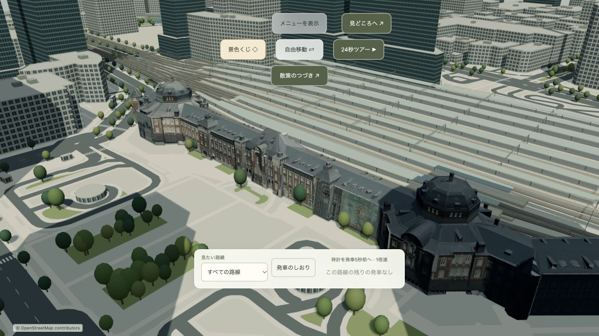
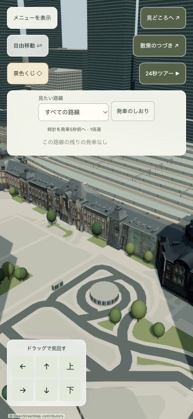

# 無料モデルを使った駅舎の実物形状への更新

2026-10-16。ローカル実装・検証済み。本番には未公開。

PLATEAU千代田区2025年度版のテクスチャ付きLOD2タイル `data446.b3dm` から、東京駅丸の内駅舎1棟（batch 4）を抽出。周囲の建物を含めず、既存の線路・ホーム・道路のシーンへ配置した。駅舎は3,165三角形、714,400 bytes、写真テクスチャは2048px。形状・UV・法線・頂点色を保持している。ロード失敗時には従来の手続き生成モデルが残る。

外壁・屋根・ドームの輪郭を元データへ変更。駅舎用の四つの照明が昼夕夜の補間に連動する。照明と地図への配置は本アプリの演出であり、測量精度を保証しない。従来駅舎のZ方向90%圧縮を、このモデルには適用していない。散策の衝突範囲は既存の保守的な駅・線路範囲内に収まる。

出典・加工内容・無料利用条件・元データと出力のSHA256・feature IDは [NOTICE.md](../../public/models/tokyo-station/NOTICE.md) と [manifest.json](../../public/models/tokyo-station/manifest.json)。再抽出コマンドはNOTICEに記載。元の公開ZIPの全量取得は不要で、今回の調査ではHTTP Rangeで中央ディレクトリと対象タイルを取得した。

## 表現上の限界

写真には工事用足場、日中の影、外壁のぼけが含まれる。データセットの年度は写真の撮影年や現在の工事状況を意味しない。完成後の駅舎を忠実に復元した保存修理モデルではない。接写における窓枠の立体感はLOD2と写真の解像度に制約がある。

Sketchfabの無料候補「Tokyo station A」も確認したが、駅舎単体ではなく広域の夜景モデルで、ビューアーが重過ぎる旨を表示。ダウンロードにはログインが必要だった。今回は取得できたPLATEAUを使用し、有料モデルは購入していない。

## 検証

- Node 24、`npm ci`、`npm test`：66件成功。`npm run build` 成功。
- GLBのヘッダー・長さ・全頂点属性の有限値・三角形数・出力ハッシュを確認。
- ローカルWorker `http://127.0.0.1:4180/` がGLBをHTTP 200、714,400 bytesで配信し、保存済みファイルと一致。
- Codex In-App Browser（Browser plugin not available。CUA経由のIABを使用）、1280×720と390×844で実画面確認。空白画面・エラーオーバーレイなし。最終ビルドのwarn/errorログなし。
- 「丸の内駅舎」の視点、昼→夜、9月16日への日時変更、14:47中央線快速の発車5秒前への移動と追従状態を確認。
- 10月の時刻表は提供元から取得できない表示。収録済み9月の時刻表では発車一覧・追従操作を確認した。10月の取得成功は未確認。
- 読込失敗時フォールバックの強制発火、実機モバイルGPU、本番公開後の確認は未実施。
- ビルドの既存chunkサイズ警告とnpm監査の5件のhigh表示は残る。依存関係は変更していない。

